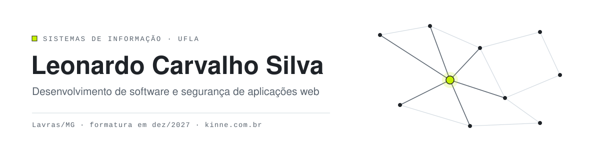

<picture>
    <source media="(prefers-color-scheme: dark)" srcset="assets/banner-dark.svg">
    
</picture>

Estudante de Sistemas de Informação na UFLA, em Lavras/MG, com formatura prevista para dezembro de 2027. Construo aplicações web do banco de dados à interface e trago para elas o que aprendi testando a segurança de sistemas reais.

Aberto a estágio ou vaga júnior remota.

### Agora

- Mantenho o **[Kinne](https://kinne.com.br)** no ar, um app de recomendação de filmes e séries que fiz e publiquei sozinho.
- Desenvolvo o **[Vecka](https://github.com/leonardocnl/vecka)**, uma lista de tarefas da semana feita para o iPhone.
- Estou modernizando o Sweet Home 3D no **[Square](https://github.com/leonardocnl/square)**, com Kotlin e jMonkeyEngine.

### Experiência

**GEDAI/UFLA** · bolsista, 10 meses 
Testes de segurança de aplicações web com OWASP Top 10 e WSTG, e desenvolvimento do frontend em Angular de um sistema para um órgão público.

### Projetos em destaque

| | |
| --- | --- |
| **[Kinne](https://github.com/leonardocnl/kinne)** · [kinne.com.br](https://kinne.com.br) | Indica um filme ou série por vez, só nos streamings que a pessoa assina. Recomendação baseada em grafo, login próprio por código enviado por e-mail e segurança pensada desde o projeto. Next.js, TypeScript, PostgreSQL e TMDB. |
| **[Show do Tonhão](https://github.com/leonardocnl/show-do-tonhao-tp1)** | Jogo de perguntas no estilo Show do Milhão, em Django, com perfis de acesso, ranking e CRUD. |
| **[PadaONE-Security](https://github.com/leonardocnl/PadaONE-Security)** | Manual de segurança produzido com o time de segurança do GEDAI: Trivy, Semgrep, Gitleaks e triagem de dependências. |

### Stack

**Linguagens** 

**Frontend** 

**Backend, dados e deploy** 

**Segurança** 

**Ferramentas** 

### Contato

